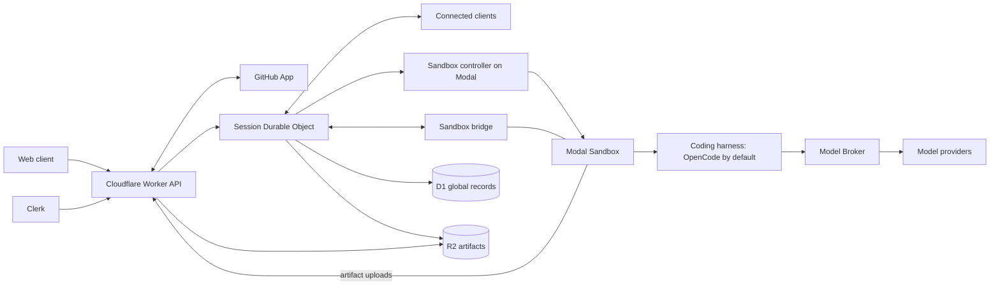

# Architecture overview

**Status:** Approved foundation

## Purpose

OnCue is a cloud-first platform for background agents. A person gives it a task; it starts an isolated remote environment, and an agent does the work with the tools there. The person can leave, come back, watch progress, give more direction, approve sensitive actions, and collect the result.

The first work profile is software development: investigating a codebase, changing code, running checks, and preparing a branch or draft pull request. Research and documents, then longer general workflows, are later profiles that should fit without replacing the core. Coding comes first because it has clear inputs, strong verification tools, and a reviewable output.

## Principles

- **Cloud-first execution.** Work runs in remote sandboxes, so sessions run in parallel, share a consistent environment, and continue when the browser closes.
- **The session is the unit of isolation.** Each session has its own durable state and, while active, its own sandbox. One session cannot block, corrupt, or read another.
- **Real tools.** The agent gets what a capable person would use: the repository, a shell, runtimes, tests, and Git.
- **Verification is part of the task.** Generated code is not proof of completion; a run's outcome rests on checks with recorded evidence (record 14).
- **Human control.** People can steer, stop, and approve or refuse actions that cross a policy boundary. Background work does not mean unlimited authority.
- **Durable records outlive compute.** A sandbox may stop, fail, or be replaced; history, approvals, checkpoints, and artifacts live outside it.
- **Platform boundaries, replaceable implementations.** Internal interfaces follow platform responsibilities, especially at the sandbox boundary (`SandboxDriver`, record 02) and the harness boundary (runtime adapters, records 02 and 04).

## System shape

Five runtime foundations:

1. **Control plane** (record 01): a Cloudflare Worker receives requests and routes session work to a Durable Object.
2. **Session coordination** (record 01): one SQLite-backed Durable Object owns each session's state and ordered event history.
3. **Remote execution** (record 02): one Modal Sandbox per active session, created in the user's own Modal workspace. A sandbox controller on Modal performs lifecycle calls for the control plane, because Modal's SDK cannot run inside Workers.
4. **Durable data** (record 03): D1 for records queried across sessions, R2 for large and immutable bytes.
5. **Agent runtime boundary** (records 02 and 04): a coding harness runs inside the sandbox behind a runtime adapter in the bridge, which normalizes its output into OnCue's event protocol. OpenCode is the default. Codex is also in the image and runs only when the operator enables it. Pi and Claude Code have adapters but are not installed in the image, so OnCue refuses them whatever the operator enables.

Records 05 to 24 cover identity, model access, GitHub, repository environments and secrets, permissions and networking, session and sandbox lifecycle, planning, the web interface, verification, model recovery, review feedback, notifications, observability, retention, deployment, scope, emergency controls, testing, and the frontend stack ([README.md](./README.md) lists them).

## Main data flow

1. The browser creates a session through the Worker API.
2. The Worker authorizes it and inserts a `session_index` row in D1 in state `creating`.
3. The Worker forwards the create command to the session's Durable Object.
4. The object commits the command and asks the sandbox controller, through the `SandboxDriver`, to start a sandbox.
5. The sandbox starts the bridge, which starts the harness.
6. The bridge streams normalized events to the object.
7. The object commits each event before broadcasting it to connected clients.
8. Large outputs are uploaded through the Worker's controlled endpoint into R2 and appear in the event stream as artifact references.
9. Selected session facts are projected into D1 through the outbox.
10. Verification runs and its evidence is recorded with the outcome.

## Ownership

| Component | Owns | Does not own |
|---|---|---|
| Cloudflare Worker | Public API, authentication, validation, routing, webhooks | Long-running agent state |
| Session Durable Object | Ordered session history, session state, client coordination | Cross-session reporting, large files |
| Modal Sandbox | Temporary execution environment and processes | Permanent history |
| Sandbox controller | Lifecycle calls, made with the workspace's Modal credential sent on each request | Stored credentials, history, policy |
| Harness | The coding-agent loop and tool execution | Identity, policy, durable storage |
| Clerk | Authentication and the account session | OnCue ownership or authorization |
| Model Broker | Authorized model requests and credential use | Conversation authority, workspace ownership |
| GitHub App integration | Repository authorization, branches, pull requests, webhooks | Session history, model behavior |
| D1 | Global records and projections | Token streams, large artifacts |
| R2 | Artifact and attachment bytes | Authorization, session state |

One owner per fact keeps two stores from becoming competing sources of truth.

## Decisions

Status labels are defined in [README.md](./README.md). `../decisions.md` records when and why each was made.

| Area | Decision | Status |
|---|---|---|
| Initial work profile | Coding first | Approved foundation |
| Execution location | Cloud-first remote execution | Approved foundation |
| API and routing | Cloudflare Workers | Approved foundation |
| Session state | One SQLite-backed Durable Object per session | Approved foundation |
| Realtime transport | Cloudflare Agents SDK with hibernating WebSockets | Approved foundation |
| Sandbox provider | Modal | Approved foundation |
| Sandbox compute account | Each user connects their own Modal workspace, which Modal bills | Approved foundation |
| Bridge isolation | Unix-user separation inside one container; Modal sidecars are limited to allowlisted workspaces. Test C passes on each image it has run on (record 02) | Tested, defence in depth |
| Sandbox internet | `outbound_domain_allowlist=["*"]`: HTTPS and DNS allowed; HTTP, raw TCP, UDP, private ranges, and metadata blocked | Tested |
| Coding runtime | A harness behind the bridge's runtime adapter, chosen per session; OpenCode by default, others in the image enabled by `ONCUE_RUNTIME_ALLOWLIST` | Approved foundation |
| Global database | D1 | Approved foundation |
| Artifact storage | R2 | Approved foundation |
| Session-to-global synchronization | Transactional outbox and projections | Approved foundation |
| Authentication | Clerk | Approved foundation |
| Workspace model | One private workspace per user | Approved foundation |
| Registration | Operator-managed allowlist; no billing or user-facing quotas | Approved foundation |
| Compute admission | Small per-workspace and platform-wide concurrent-sandbox caps | Approved foundation |
| Model access | User-provided API keys and provider-approved subscription connections | Approved foundation |
| Model credential boundary | Model Broker with short-lived sandbox tokens | Approved foundation |
| Source control | GitHub through a GitHub App; one OnCue branch per session | Approved foundation |
| Pull requests | Draft pull requests; the user controls timing through chat policy | Approved foundation |
| Repository setup | Automatic detection plus optional `.oncue/project.yaml` | Approved foundation |
| Repository secrets | Development-only secrets with per-session disclosure | Approved foundation |
| Agent authority | Tiered permission model | Approved foundation |
| Previews | Authenticated gateway on a separate browser origin | Approved foundation |
| Session behavior | Ongoing conversation with sequential runs | Approved foundation |
| Sandbox idling and resumption | Checkpoint and stop after about 20 minutes of inactivity; a replacement sandbox resumes from durable state | Approved foundation |
| Agent topology | One primary agent per active run | Approved foundation |
| Planning | Concise visible plans; optional wait-for-approval policy | Approved foundation |
| Main interface | Conversation-first workspace with review panels | Approved foundation |
| Completion | Verified, completed with warnings, done, blocked, failed, or cancelled; checks run when a run changed files, on request, and before a push of unchecked code; evidence is required for verified and shown in the session and draft pull request | Approved foundation |
| Model failure recovery | Bounded retries on the selected model, then pause; switching model is the user's choice, never automatic | Approved foundation |
| Pull-request reviews | Import feedback into the original session; update the same branch and pull request | Approved foundation |
| Notifications | In-app plus optional browser notifications | Approved foundation |
| Observability | OpenTelemetry-compatible signals, Sentry error reporting, privacy-safe fields | Approved foundation |
| Retention | Keep conversations and essential evidence until deletion; temporary artifacts expire after 90 days | Approved foundation |
| Deletion | Tracked across OnCue storage; GitHub branches and pull requests remain | Approved foundation |
| Environments | Local development plus one shared hosted environment; no staging | Approved foundation |
| Hosted topology | Application and control plane on Cloudflare, execution on Modal | Approved foundation |
| Emergency controls | Stop new runs, terminate one exact session, revoke credentials | Approved foundation |
| Test coverage | Every supported requirement and meaningful failure path automated; complete branch coverage for security, isolation, state, credential, and deletion modules | Approved foundation |
| Hosted test gate | Live end-to-end tests pass before the shared deployment is accepted | Approved foundation |
| Frontend | React, TypeScript, Vite with the Cloudflare plugin, Tailwind CSS, shadcn/ui on Base UI, Vercel AI Elements source; client-rendered | Approved foundation |
| Vercel AI SDK | Not a dependency | Deferred |
| Durable workflow engine | None | Deferred |
| Database outside D1, vector database | None | Deferred |
| Shared platform model key | None | Deferred |
| Admin product | No admin dashboard or abuse-management system | Deferred |

## Not built yet

Several approved foundations are designed but not implemented. Each record says what exists; `../roadmap.md` and `../backlog.md` track the rest. The largest gaps:

- Concurrent-sandbox caps, the operator's stop switch and termination route, and audit records (records 01 and 22).
- Previews (record 09), notifications (record 17), pull-request review import (record 16), and model retries (record 15).
- OpenTelemetry and Sentry; the Worker writes structured logs to Workers Logs only (record 18).
- Account deletion, the 90-day artifact sweep, and projection reconciliation (records 03 and 19). Session deletion is built.
- Subscription model connections (record 06).
- Repository-preparation images and caches (records 02 and 11), and Pi and Claude Code in the sandbox image (record 02).

## Deferred

Staging and production-customer environments; formal release promotion, canaries, and disaster recovery; admin dashboards and automated abuse controls; a repository compatibility matrix; a statistical agent-evaluation platform; high-scale load architecture; shared workspaces, production access, and non-coding work profiles.

## Conditions for reconsideration

Revisit this architecture if sessions need transactions or queries across many session databases; D1 limits constrain global queries or writes; work routinely spans days with complex timers or compensation; Modal cannot provide the needed isolation, regions, performance, or cost control; no supported harness can serve a needed work profile or model capability; artifacts need frequent in-place updates; or regulation demands different data placement. Until then, prefer this smaller architecture over more infrastructure.
